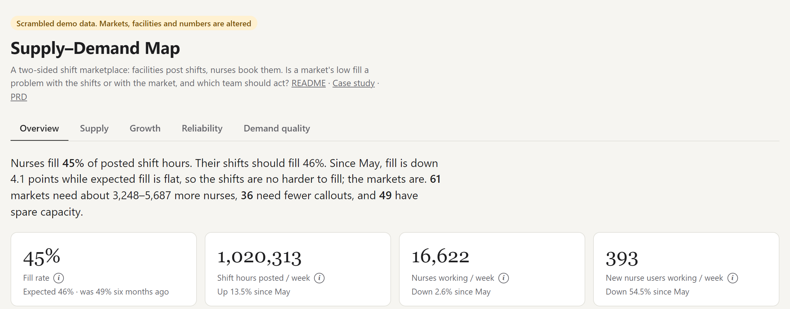
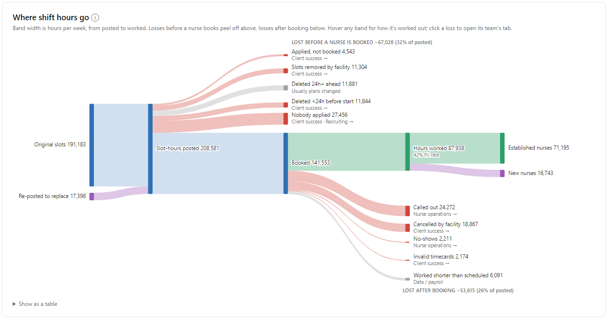
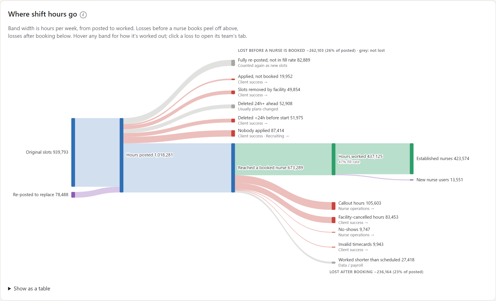
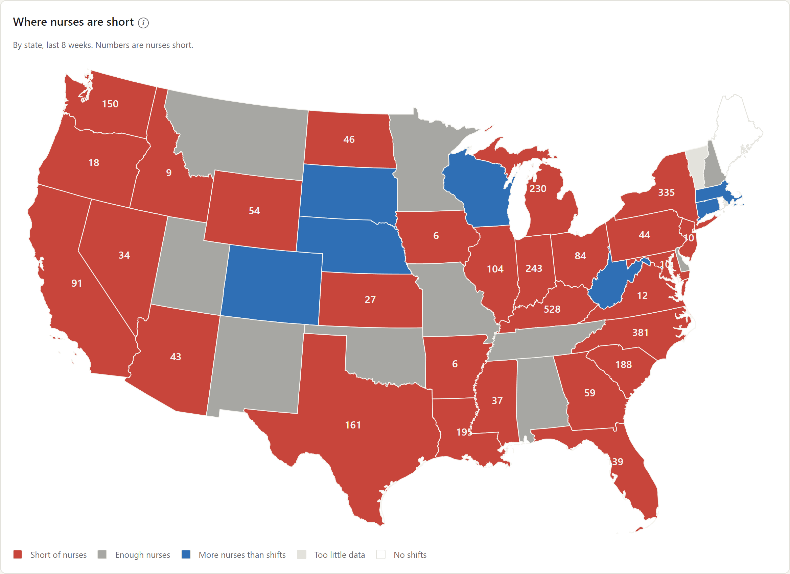
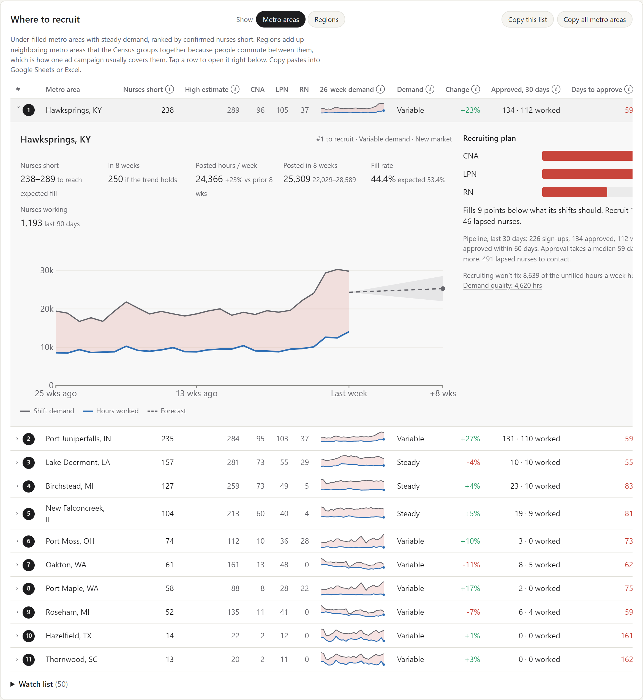

# Market Map: finding where a staffing marketplace is short on supply, and why

I built an internal decision tool for a two-sided nurse staffing marketplace, where facilities post per diem shifts and nurses book them. Marketing asked where to spend its paid ads. The data showed that most unfilled hours weren't caused by a shortage of nurses. The tool now tells each team whether a market needs more nurses, fewer callouts or better-posted shifts, and who should act.

**[Try the live demo](https://josephfanpm.github.io/Marketplace-Demand-Supply/)** · [Full case study](docs/CASE_STUDY.md) · [Requirements (PRD)](docs/PRD.md)

Try this first: compare the two lines in **Fill rate vs expected**, then open the **Supply** tab and tap the top market in **Where to recruit**.



The demo runs the real tool's page on scrambled data, built for this portfolio. **Every market, facility, name and number in the demo is altered**: markets are moved to random metro areas under invented names, facilities are invented, volumes are scaled several times over, and rates are shifted. The one exception is a screenshot of the real tool's "Where shift hours go" view below. The company's underlying data and SQL aren't in this repo.

<!-- TODO(Joseph): Name the company in "At a glance" if you're comfortable, as in your other case studies. -->

## At a glance

| | |
|---|---|
| **Company** | A two-sided nurse staffing marketplace: nursing homes post per diem shifts, CNAs, LPNs and RNs book them |
| **Ask** | "Where should marketing ramp up paid ads?" A map of new facilities and thin nurse supply |
| **What I found** | Most unfilled hours came from facility practices and callouts, not a nurse shortage. Ads can't fix those |
| **What I built** | A five-view internal tool for leadership, recruiting and marketing, client success, nurse operations and sales. Each market gets a status, an owner and a next step |
| **Core idea** | Compare each market's actual fill with the fill its shifts *should* get from their traits alone. Below expected means a market problem; low expected means a shift problem |
| **Status** | Live for internal teams as a Claude artifact; ported into the company's internal tools platform (in review); data moving to tables rebuilt daily |
| **Lesson** | The first question ("where are we short?") was the wrong one. The useful question was "why is this hour unfilled, and who can fix it?" |

## Problem

Fill rate (hours worked ÷ hours posted) is the marketplace's core health metric, and it had been sliding while demand grew. The default explanation was "not enough nurses", which made recruiting and paid ads the default fix.

Three things made that risky:

1. **Losses happen at different steps, with different owners.** A posted hour can be lost before anyone books it (nobody applies, the facility deletes it late, the slot needs a manager's approval) or after booking (a callout, a no-show, a cancellation). Only some of those are a supply problem.
2. **Some shifts are hard to fill anywhere.** Late posting, pay below the local rate, approval steps, weekends and nights all lower fill. Recruiting more nurses into a market with hard-to-fill shifts wastes acquisition spend.
3. **Teams worked from different numbers.** There were several "fill rates" in circulation (the official one, a slot-based one, and my own early "real demand" version), and nothing tied a lost hour to the team that could act on it.

## Target users

| User | Question they bring | What they get |
|---|---|---|
| **Leadership** | Is supply keeping up with demand, and where isn't it? | An overview with fill vs expected fill, a flow of where posted hours go, a state map and the biggest gaps |
| **Recruiting, marketing, paid ads** | Where do we recruit, and for which license? | Ranked markets with nurses short by license, the hiring pipeline, approval times and likely returns |
| **Client success** (owns facility relationships) | Which facilities do I call, and what do I ask them to change? | A facility list with late deletions, removed slots, approval steps, pay vs local rate and expected fill |
| **Nurse operations** | Where are callouts and no-shows costing us? | Weekly trends, repeat callers, and the facilities hit hardest |
| **Sales / account managers** | Where can we sell more? | Markets with spare capacity, where account managers should close leads |

## Solution

| Area | Before | After |
|---|---|---|
| Question answered | Where are nurses thin? | Why is each hour lost, and who can fix it? |
| Unit | A single fill rate per state | Posted hours traced to an outcome (worked, open, deleted, removed, cancelled, called out, no-show), with an owner for each |
| Diagnosis | Low fill = recruit | Actual vs expected fill separates "the market can't fill good shifts" from "the shifts are hard to fill" |
| Supply view | Headcount | Active nurses nearby, nurses who've worked at that facility, the hiring pipeline, organic returns, and a nurse-level supply forecast |
| Output | A map | A status and next step per market: Recruit nurses, Improve reliability, Fix shifts, Healthy, Spare capacity |
| Executive view | n/a | One page: fill vs expected, a Sankey of posted hours, a state map, the biggest gaps and spare capacity |

### The real tool



*The internal Market Map's executive view: a week of slot-hours, averaged over 8 weeks. Re-posted replacement slots flow in on the left; losses before a nurse is booked peel off above, losses after booking below, each with the team that owns it; hours worked split into established and new nurses on the right.*

### The demo (scrambled data)

| Screen | What it shows |
|---|---|
|  | **Where shift hours go.** Hours lost before booking peel off above, losses after booking below. Every red branch has an owning team; click one to open its tab |
|  | **Where nurses are short.** States short of nurses (with counts), with enough nurses, or with more nurses than shifts |
|  | **Where to recruit.** Markets filling well below what their shifts should, ranked by nurses short, with license mix, demand trend, pipeline and lapsed nurses. Tap a row for its plan |

## My role

Product manager, and the person who built it. I:

- Reframed the ask from "where to spend ads" to "why hours go unfilled", after breaking unfilled hours down by outcome.
- Researched how other marketplaces measure supply and demand (liquidity by market, unmet-demand heatmaps, fill rate by market in staffing apps, capacity gap vs execution gap) and adapted the patterns to scheduled shifts.
- Did the analysis in the data warehouse, including the validation work: checking whether more nearby nurses actually raise fill at the same facility, testing pay and approval effects, and measuring a win-back campaign against its control group.
- Built three models: a shift fill-likelihood model, a callout-risk model, and a nurse-level "works in the next 4 weeks" supply model. I then chose how much of them to put in front of the business.
- Designed and built the dashboard, iterating with stakeholders through about 15 rounds of feedback on naming, layout and actionability.
- Wrote the daily data models and the data-team tickets (daily tables, ad attribution fixes), and ported the tool into the company's internal tools platform.

<!-- TODO(Joseph): Optional: who you worked with (data team, client success, recruiting, leadership) and how teams use it, if you're comfortable sharing. -->

## Key decisions and trade-offs

| Decision | Options considered | Chosen | Given up | Why |
|---|---|---|---|---|
| **What question the tool answers** | Map of thin supply for marketing; diagnosis of every lost hour for all teams | Diagnosis for all teams | A simple single-team map | Most lost hours weren't a nurse shortage, so a recruiting-only map would have sent spend to problems ads can't fix |
| **Which fill rate** | My "real demand" version; slot fill; the company's official definition | Official definition everywhere | A cleaner-looking number that excludes plans that changed | One number for leadership. Its quirks (re-posted slots, early deletions) are explained in tooltips and drawn in the flow diagram instead |
| **How models are used** | Split every lost hour into causes with model coefficients; use the model only as a benchmark; no model | Benchmark: expected vs actual fill | Precise-looking "hours lost to low pay" numbers | The cause split rests on associations, and no one was going to run experiments to confirm it. A benchmark can be checked monthly against what happened and still answers "fix the shifts or recruit?" |
| **What goes into expected fill** | Every predictive input; shift traits only | Shift traits only (pay vs local, posting time, approval, weekend, night, slots, license) | Some accuracy | Supply inputs, and "few reviews" (which really measures how few nurses have been there), would explain away the very shortage the tool needs to find |
| **Nurses short** | Hours ÷ average hours; a single number; a range | A range, only for markets marked Recruit | A single headline number | New nurses work different hours from established ones. Counting only Recruit markets keeps callout-driven gaps out of the recruiting ask |
| **Executive view** | Bars by cause; a funnel; a circular flywheel; a Sankey | Sankey of posted hours | The familiar flywheel diagram | Shows hours moving and where they drop out, and puts an owner on each loss. The flywheel's "more fills → more posts" loop wasn't supported by the data |
| **Map** | Metro dots; state choropleth; ranked list | State map plus ranked lists | Metro detail on the map | Executives read states quickly; ranked lists catch short metros inside healthy states |
| **Live queries vs daily tables** | Query the warehouse on every view; precompute daily | Precompute daily in dbt | Real-time numbers | Load time dropped from about a minute to instant, everyone sees the same numbers, and viewers don't need warehouse access. The data only changes daily anyway |
| **Individual risk scores** | Show callout risk and churn risk per nurse; keep them out | Keep out of the market tool | A richer recruiting tab | Person-level scores belong in operations tools, not on a market dashboard |

## Success metrics

**Validation before rollout** (no business results claimed)

| Check | Finding |
|---|---|
| Does more nearby supply raise fill? | At the same facility over time, fill responded to nearby nurses only in thin markets. That's why "nurses short" is restricted to markets the benchmark flags |
| Is expected fill trustworthy? | On weeks it never saw, predicted fill matched actual fill within a few points in every tenth of the range. The model is calibrated, even though it ranks shifts only moderately well |
| Is the expected-vs-actual split meaningful? | Markets far below expected were the known shortage markets; markets far above were the known strong ones |
| Do win-back campaigns work? | A bonus campaign pulled shifts earlier but didn't bring back more nurses than its control group by 90 days. That became the baseline any campaign has to beat |

**KPIs I'd track for the tool** (tracking metrics, no values claimed)

| KPI | Why it matters |
|---|---|
| Gap between actual and expected fill in Recruit markets | Recruiting should close it |
| Expected fill in Fix shifts markets | Client success changing posting time, approval and pay should raise it |
| Share of lost hours by owner (facility practices, reliability, supply) | Shows whether each team is moving its part |
| Callout refill rate | Refilling fast is as big a lever as preventing callouts |
| Days from sign-up to approval in short markets | Pipeline speed, not top-of-funnel, was the bottleneck in some markets |
| Weekly active viewers by team | Whether each team uses its view |
| Model calibration after each monthly refit | Keeps the benchmark honest |

## Roadmap

My proposed next steps. These are recommendations, not a committed company roadmap.

| Horizon | Item | Why |
|---|---|---|
| **Now** | Daily dbt tables and warehouse access for the internal tools app | Instant loads, the same numbers for everyone, no per-viewer warehouse access |
| **Now** | Monthly refit of the expected-fill model, with a calibration check | Fill drifts month to month; the benchmark has to follow |
| **Next** | Fix ad attribution: restart install tracking, real spend by region, channel on every lead | Unlocks cost per working nurse by market, so paid ads can move budget with evidence |
| **Next** | Nurse-level supply forecast and callout risk, written to the warehouse on a schedule | Replaces the straight-line demand trend with a supply forecast, and feeds operations tools |
| **Later** | Log the actions taken (facility calls, campaigns) against market status | Closes the loop: did the action move fill vs expected? |
| **Later** | Holdout groups for every outreach campaign | Measure what campaigns change, not who would have come back anyway |

## Technical fluency

| Layer | Detail |
|---|---|
| Warehouse and modelling (production) | BigQuery and dbt; logistic regression for expected fill (hours-weighted, shift traits only); gradient boosting and logistic models for callout risk and nurse-level supply, evaluated on later weeks they never saw |
| Dashboard (production) | A Claude artifact (D3, live warehouse queries) for fast iteration, then ported to an Angular + NestJS internal tools monorepo behind admin login, with the calculations in pure functions and unit tests |
| This demo | [`docs/index.html`](docs/index.html): the same D3 page as the production dashboard (five team tabs, Sankey, weekly trend, state map, metro-area map with zoom, recruiting list, facility tables and scatter), running on scrambled data in [`docs/demo-data.js`](docs/demo-data.js) through a small stand-in for the dashboard runtime ([`docs/dash-shim.js`](docs/dash-shim.js)). [`generate.py`](generate.py): a separate simulation that fits the expected-fill model on data with known "true" effects |
| Hosting | GitHub Pages from `/docs` |

Choices worth noting:

- **Scrambled numbers, real method.** Every market sits on a randomly chosen US metro area under an invented name, facilities are invented, volumes are scaled several times over, and fill rates are shifted. The page logic, statuses and rankings are the real tool's.
- **No confidential data.** No company names, facility names, SQL or real market locations are published.
- **Fitted vs true effects.** `generate.py` simulates a marketplace with hidden "true" effects, then fits expected fill. They differ, which is the point: expected fill describes typical fill, not causes.

## Try the demo

- **Overview:** compare fill rate with expected fill, follow posted hours to worked hours in the Sankey (click a red loss to open its team's tab), and hover a state on the map.
- **Supply:** the recruiting list, ranked by nurses short. Tap a market for its 26-week demand, 8-week forecast and recruiting plan. Switch to Regions to group neighboring metro areas.
- **Growth:** metro areas with new facilities, and whether each needs nurses, is ramping well, or has no shifts yet.
- **Reliability:** hours lost to callouts and no-shows, how concentrated callouts are among repeat callers, and the facilities hit hardest.
- **Demand quality:** fill by posting lead time, approval and pay against the local rate, and which facilities to call first.

## Getting started

```bash
pip install -r requirements.txt
python -m http.server -d docs 8000  # open http://localhost:8000 to run the demo
python generate.py                  # optional: the method simulation, writes docs/data.json (about 1.5M simulated slots)
```

## Limitations

- **The demo is scrambled.** The page, method and product decisions follow the real tool; the demo's markets, names and figures don't. Only the "real tool" screenshot shows actual figures.
- **The benchmark is relative.** Expected fill is calibrated to today's average, so it finds markets below par, not the absolute shortage.
- **Thresholds are judgement calls.** ±8 points from expected, and 4 points of harder-than-typical shifts, are kept in config so they can be tuned.
- **Not every model is in the tool yet.** The supply forecast and callout-risk models were built and validated but aren't wired into the production tool; that needs scheduled scoring in the warehouse.
- **Paid-ads cost per hire by market isn't possible yet,** because attribution data has gaps (see roadmap).
- **No business impact is claimed.** The tool is new.

## Credits

Built by Joseph Fan ([@josephfanpm](https://github.com/josephfanpm)). An independent portfolio project, not an official company tool. Every market, facility and figure in the demo is altered. MIT licensed.
