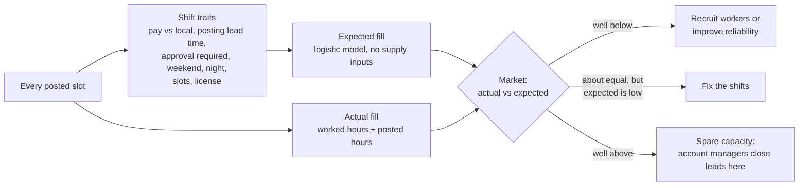

# Supply–Demand Map for a shift marketplace

A case study in building an internal decision tool for a two-sided marketplace. Facilities post shifts and workers book them. I wanted the tool to answer one question: **when a market fills poorly, is the problem the shifts or the market?**

> **Everything in this repo is synthetic.** The markets, names and numbers are simulated by `generate.py`. The method and the product thinking come from a tool I built for a healthcare staffing marketplace. The data, the SQL and the company's results are not here.

**[Live demo (synthetic data)](https://josephfanpm.github.io/eshyft-demand-supply/)** · [`generate.py`](generate.py) simulates the marketplace and fits the model

---

## The problem

The first brief was a map for marketing: where are new facilities opening, and where is worker supply thin, so paid ads can ramp up in the right places.

That brief rested on an assumption: unfilled shifts mean too few workers. Breaking unfilled hours down by what actually happened to each posted slot showed that most were lost elsewhere:
- **Facility practices:** facilities deleted shifts at the last minute, posted late, made bookings wait for a manager, or never confirmed applicants.
- **Reliability:** workers called out or didn't show.

Only part of the loss was a genuine shortage of workers. A map that told marketing to buy ads everywhere fill was low would have spent money on problems ads can't fix.

So the tool became a decision aid for several teams:

| View | Who uses it | What they do with it |
|---|---|---|
| Overview | Leadership | See whether supply is keeping up with demand, and where it isn't |
| Recruiting | Recruiting, marketing, paid ads | Recruit by license in the markets that can't fill shifts that should fill |
| New markets | Sales, recruiting | Check whether new facilities are ramping up |
| Worker reliability | Operations | Refill faster and follow up with frequent callers |
| Facility practices | Client success | Ask specific facilities to post earlier, turn on instant book, or pay closer to the local rate |

## The core idea: compare actual fill with expected fill



The model predicts how well a shift should fill from its traits alone. It deliberately leaves out how many workers are nearby. That turns it into a benchmark:
- **Low expected fill** means the shifts are hard to fill: posted late, paid below the local rate, behind an approval step, on weekends or nights. Recruiting won't fix that. Changing the shifts will.
- **Actual fill well below expected** means the market can't fill shifts that should fill. That's a supply or reliability problem.
- **Tracked weekly,** it separates the two over time. In the synthetic demo, expected fill stays flat while actual fill falls, so the market lost capacity; the shifts didn't get harder.

Workers short is then computed from the hours below expected: the hours a market misses each week ÷ the weekly hours a worker covers. It's shown as a range, because new workers and established workers put in different hours.

## How supply and demand are measured and forecast

| Piece | How | Why this way |
|---|---|---|
| Demand | Slot-hours posted per week, following the company's official fill-rate definition | Using one definition everywhere avoids executives seeing two "fill rates" |
| Demand forecast | Straight-line trend over the last 26 weeks, projected 8 weeks ahead, with a band covering about 8 in 10 weeks; each market labelled steady, variable or volatile by how much weekly demand swings | Simple, explainable, and honest about uncertainty. A market with volatile demand isn't a good place to invest in recruiting |
| Supply now | Active workers nearby, and how many have worked at that facility before | Familiar workers turned out to be a stronger supply signal than headcount: people book places they already know |
| Supply forecast | A worker-level model of "works in the next 4 weeks" (signals: shifts already booked, browsing activity last week, days since last shift), added up by region | A region-level time series couldn't beat a naive "same as last week" baseline: too little history, and the trend reversed. Scoring individual workers and summing worked better, and the scores can also target retention outreach |
| Supply inflow | Pipeline by market: sign-ups, approval rate, days to approve, first shift | Sometimes the bottleneck is how fast applicants get approved, not how many sign up |
| Organic returns | Share of lapsed workers who come back with no outreach, measured from a campaign's held-out control group | The baseline any win-back campaign has to beat |

## How this compares to other marketplaces

| Pattern | Where it comes from | What I took | What's different in shift staffing |
|---|---|---|---|
| Liquidity, measured per market | a16z and Point Nine on marketplace liquidity | Fill rate as the headline, broken down by geography | Shifts are booked days ahead, so how early a shift is posted matters as much as pay |
| Heatmaps of unmet demand | Ride-hailing operations dashboards | A map, kept to a few plain categories for executives | Demand is scheduled, not instant, so lost hours have clear stages: before booking and after booking |
| Fill rate by market | Staffing marketplaces (Qwick, DirectShifts benchmarks) | Market ranking and benchmarks | Two-step booking (manager approval) is a big, fixable cause of lost hours |
| Capacity gap vs execution gap | RevOps and workforce tools | "Not enough supply" kept separate from "supply not converted" | Implemented as expected vs actual fill, rather than as a list of causes |
| Supply–demand flow | Funnel and Sankey analysis | Where hours flow in and out, with an owner on every loss | Callouts get refilled, so replacement slots flow back in |

## Trade-offs I made

1. **A benchmark, not a list of causes.** My first version split every lost hour into causes ("lost to low pay", "lost to posting late") using the model's coefficients. It was precise but not defensible: those are associations, the team wasn't going to run experiments to confirm them, and the split depends on an arbitrary allocation rule. The expected-vs-actual benchmark claims less. It can be checked every month against what actually happened, and it still answers whether to fix the shifts or recruit.
2. **The official metric, quirks included.** The company's fill-rate definition counts re-posted replacement slots and early deletions as posted hours. I adopted it anyway, so leadership sees one number, and I explained the quirks in tooltips and in the flow diagram rather than inventing a "better" number.
3. **Some predictive power traded for honesty.** The expected-fill model is only moderately accurate at ranking shifts, because traits explain part of fill and the market explains the rest. That's the point: the unexplained part is the market signal. It is well calibrated, which matters more for a benchmark.
4. **Inputs I removed on purpose.** Facility reviews and "has few reviews" were predictive. But "few reviews" mostly measures how few workers have been there, which is supply, and would have hidden real shortages at new facilities.
5. **Hours vs people.** Recruiting thinks in people; the data is in hours. Converting hours to workers needs an assumption about hours per worker, so it's shown as a range.
6. **The executive view vs the team views.** The overview is a flow diagram, one trend chart, one map and two short lists. Detail lives in the team tabs. A state map is simple, but it hides short metro areas inside healthy states, so a ranked list sits next to it.
7. **Live queries vs precomputed tables.** Live queries were cheap but slow, and each viewer needed warehouse access. The data changes daily, so it moved to tables rebuilt once a day: the same numbers for everyone, loading instantly.
8. **What I didn't put on the market dashboard.** Individual risk scores (who will call out, who will stop working) belong in operations tools, not on a market-level view.

## Actionable insights (described in general terms)

These are the kinds of conclusions the tool produced. The figures in the demo are synthetic.

- **Most lost hours weren't a worker shortage.** Late deletions, approval steps, late posting and callouts together outweighed the shortage. Each loss now has an owning team, and the biggest wins went to client success and operations, not marketing.
- **Flat expected fill with falling actual fill means a capacity problem.** That pointed at recruiting and retention, not at shift design.
- **Requiring approval to book a shift is a large, fixable cause.** Shifts that need a manager's approval fill far less often than instant-book shifts.
- **Familiarity drives booking.** Getting nearby workers a first shift at a facility can close a gap faster than recruiting new people.
- **Refills are a flow back in.** Refilling callouts quickly is as big a lever as preventing them.
- **Pipeline speed matters.** In some short markets, approval took weeks, so speeding it up beats adding sign-ups.
- **Measure win-back against a holdout.** A bonus campaign pulled shifts forward without bringing back more workers overall. Without a control group it would have looked like a win.

## Run it

```bash
pip install numpy scikit-learn
python generate.py                 # writes docs/data.json from a fresh simulation
python -m http.server -d docs 8000 # open http://localhost:8000
```

`generate.py` simulates about 1.5 million posted slots across 64 fictional markets in all 48 continental states and DC over 26 weeks. Each market has a hidden supply strength, and a third of markets lose supply over time. It then fits the shift-trait model on the latest 8 weeks, labels each market, and writes the demo data. The fitted coefficients sit next to the true ones in `docs/data.json`. They differ a little, a reminder that the model describes typical fill and isn't a causal estimate.

## Limitations

- The benchmark is relative: it's calibrated to today's average fill. It measures which markets are below par, not the absolute shortage.
- Thresholds (±8 points, 4 points of harder shifts) are judgement calls, kept in config so they can be tuned.
- A model like this needs monthly refitting, or its expected fill drifts as the marketplace changes.
